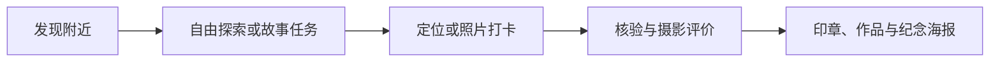

# 东京支线 · Tokyo Side Quest

**不用做攻略，花一小时，成为一段东京故事的主角。**

An open product specification for location-based Tokyo exploration, AI photo check-ins, story quests, and collectible travel posters.

> 当前阶段：产品定义与开发规格。仓库目前提供可交给开发 AI 执行的详细文档，尚未包含可运行的应用程序。

## 产品构想

东京支线将附近地点、原创城市故事和摄影探索连接起来：

1. **发现附近**：定位当前位置或手动选择街区，发现可以探索的地点。
2. **领取支线**：选择一段有开场、线索、任务和结局的街区故事，也可直接自由探索。
3. **完成打卡**：定位打卡或拍照打卡，两种入口独立可用。
4. **AI 地点核验**：将用户照片与经过审核的真实地点参考资料对比。
5. **摄影评级**：地点匹配后，按构图、光影、清晰度和场景表达给予 SSS、SS、S、A、B、C、D 七档评价。
6. **收藏与分享**：保存作品、足迹和城市印章，生成个人纪念票根海报。

## 开发文档

请从 [AI 开发执行文档](docs/development-spec.md) 开始。

文档包含 24 个章节：

- 产品目标、首版范围与页面级流程。
- 系统架构、数据模型、API 合同与异步任务。
- 定位范围、图片处理、AI 地点核验与七档摄影评分规则。
- 故事进度、奖励幂等、人工复核与异常恢复。
- 视觉规范、海报分享、数据删除与运行配置。
- 分阶段实施计划、测试场景、AI 评估与最终验收清单。

**交给 AI 开发时**：提供完整文档，并使用其中第 22 节的启动提示词。先实现一条真实纵向链路，再扩展首版功能。

## 首版实施范围

计划从一个东京街区开始：

- 6 个经过资料核对的地点档案。
- 1 条完整原创故事，包含 4 个主要任务节点。
- 地图、列表与真实定位打卡。
- 图片上传、真实 AI 地点核验和摄影评价。
- 访客数据持久化、城市印章与可恢复的任务进度。
- 海报下载、主动分享与撤销。
- 数据隔离、明确标识的在线试玩。
- 基础内容管理与人工复核后台。

以上为开发目标，尚未代表已实现能力。具体优先级与完成条件以开发文档为准。

## 核心业务规则

- **地点核验与摄影评分分开**：照片不匹配地点时，不生成摄影 D 级。
- **两种打卡方式独立**：不能擅自要求同时提供定位和照片。
- **证据准确表达**：相册照片匹配不等于用户正在现场，设备定位也不作为不可伪造的到访认证。
- **真实模式不使用假 AI**：缺少模型服务时明确提示不可用，不随机生成成功结果和等级。
- **真实参考图有来源**：AI 生成宣传图不能作为地点识别参考。
- **服务端决定事实**：分数、等级、任务进度和奖励由服务端验证、持久化和去重。

## 建议技术架构

新项目默认方案为 Next.js、TypeScript、PostgreSQL/PostGIS、S3 兼容对象存储、Redis/BullMQ、独立 Node.js Worker、MapLibre 和可替换的视觉模型 Adapter。

此处是架构建议，仓库当前没有安装依赖或启动脚本。依赖版本、服务提供方与部署方式由实现阶段核实并记录。

## 贡献

欢迎改进产品规格、补充有来源的东京地点资料，或按照首版范围推进实现。请先阅读 [贡献说明](CONTRIBUTING.md)。

新增真实地点、坐标与参考照片时，应记录资料来源、核对日期和图片使用依据。不要提交私人照片、密钥、会话令牌或未获授权的第三方素材。

## 方法与资料

构思参考了 [phuryn/pm-skills 的 brainstorm-ideas-new](https://github.com/phuryn/pm-skills/blob/main/pm-product-discovery/skills/brainstorm-ideas-new/SKILL.md)，视觉方向参考了 [anthropics/skills 的 frontend-design](https://github.com/anthropics/skills/blob/main/skills/frontend-design/SKILL.md)。

东京内容来源与技术参考链接记录在开发文档中。本站点构想为独立项目，不表示与东京官方机构、商家或上述开源项目存在合作或背书。

## 许可证

本仓库原创内容采用 [MIT License](LICENSE)。第三方资料、照片和链接目标的权利仍归各自权利人，使用前需另行确认授权。
