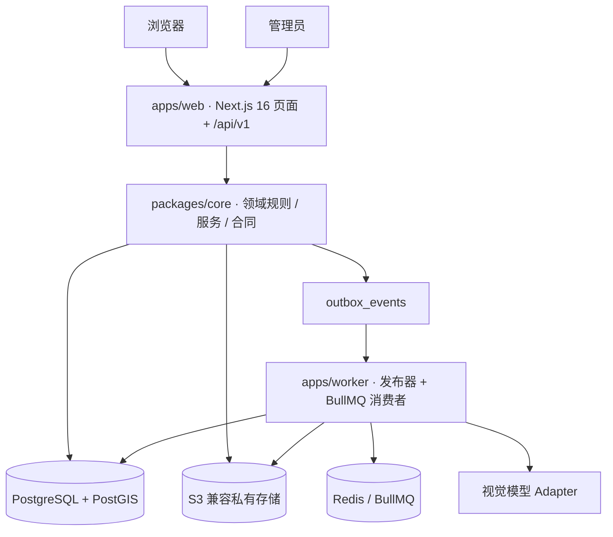

# 架构

## 总览



| 层 | 规格默认方案 | 实际实现 |
| --- | --- | --- |
| Web | Next.js App Router + TS | Next.js 16.4（Turbopack，Cache Components + Partial Prefetching），TypeScript 严格模式 |
| 地图 | MapLibre GL JS | MapLibre GL 5；`MAP_STYLE_URL` 可配置，未配置时只显示列表 |
| 数据库 | PostgreSQL + PostGIS | postgis/postgis 17-3.5，`geography(Point,4326)` + GiST 索引 |
| 数据访问 | Drizzle + 版本化 SQL 迁移 | Drizzle ORM 0.45 + drizzle-kit 迁移；PostGIS 查询使用参数化 SQL |
| 对象存储 | S3 兼容；本地 MinIO | S3 SDK；本地用 **SeaweedFS**（MinIO 已停止发布社区镜像，见 decisions） |
| 队列 | BullMQ + Redis | BullMQ 6 + Redis 8；DB outbox 由 Worker 发布 |
| Worker | 独立 Node 进程 | `apps/worker`（tsx），并发：照片 4、海报 2、维护 1 |
| 图片处理 | sharp | sharp 0.35：校验真实格式、校正方向、去除 EXIF、生成 2048/1568/480 三个尺寸 |
| 视觉 AI | 可替换 Adapter | `anthropic`（@anthropic-ai/sdk，结构化输出）/ `openai-compatible` / `fake`（仅测试环境） |
| 校验 | Zod | Zod 4：API 输入严格模式，AI 输出另加业务规则约束 |
| 测试 | Vitest + Playwright | Vitest（unit / integration 两个项目）+ Playwright（试玩、接口安全、隔离的真实模式测试部署） |
| 海报 | 服务端固定模板 | satori + resvg，内置 Noto CJK 字体，输出 1080×1440 PNG |

## 代码组织

```text
apps/web/            页面、/api/v1 路由（薄封装）、客户端组件
apps/worker/         outbox 发布、照片/海报/维护任务、心跳、定时清理
packages/core/src/
  domain/            评分、等级、定位判定、状态枚举（纯函数 + 单元测试）
  contracts/         API 请求与 AI 输出的 Zod schema
  db/                schema、迁移、种子
  ai/                provider、提示词（带版本）、结构化调用与一次受控重问
  storage/           S3 封装、图片标准化
  queue/             队列定义、outbox
  services/          业务事务：会话、地点、打卡、奖励、照片尝试、处理、故事、海报、删除、后台
  posters/           票根模板与品牌素材
content/             谷中地点、故事、参考图来源清单、调研记录
tests/               集成测试、Playwright
```

核心业务规则只放在 `packages/core`，不写在 React 组件或提示词字符串里。

## 照片尝试的生命周期

1. `POST /photos`：上传后立即标准化，只保存去除 EXIF 后的版本。
2. `POST /photo-attempts`（带 Idempotency-Key）：
   - 检查 AI 是否已配置、限流、照片归属、地点是否开放照片核验、故事节点条件。
   - 用 `访客 + 模式 + 地点版本 + 参考库版本 + 图像哈希 + 各版本号` 计算 **evaluation 缓存键**，用 `评估键 + 上下文键` 计算 **attempt 去重键**。
   - 在同一个事务里写入 attempt 和 outbox。
3. Worker 核验阶段：
   - 先读最新状态，已完成或已取消就直接退出。
   - 优先复用缓存的评估结果，否则调用模型。调用期间不持有数据库锁。
   - 匹配时，在一个事务里写核验记录、打卡、印章和故事节点，再写入评分事件。
4. Worker 评分阶段：分数和等级由服务端计算，更新历史最佳。
5. 技术错误交给 BullMQ 指数退避重试，最多 3 次；最终失败只标记出错的那个阶段，用户可以只重试这一阶段。

三类状态（processing / verification / rating）分开存储、分开展示。

## 数据隔离与安全

- `mode = live | demo` 写在每一条访客数据上；试玩接口在 `/api/v1/demo/*` 下，只接受固定样例。
- 会话令牌、分享令牌都只存 HMAC 哈希；分享令牌另外用 AES-GCM 加密保存，以便所有者再次复制链接。
- 所有写接口都做同源校验（Origin / Sec-Fetch-Site）；所有读取都做所有权校验，UUID 难以猜测不作为安全依据。
- 管理员使用独立的 Cookie 和会话表，按角色鉴权，访客会话无法升级为管理员。
- 公开分享接口只返回票根上本来就印着的字段，图片经由可撤销的接口读取，并设置 `no-store`。

## 与规格的差异

见 [decisions.md](decisions.md)。
